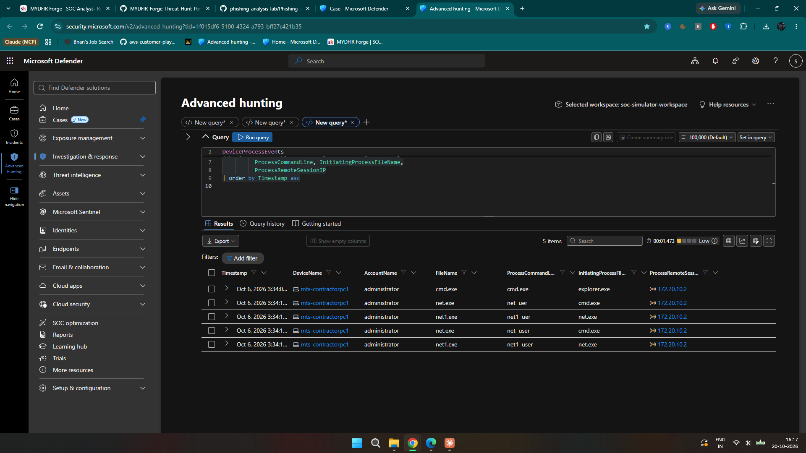
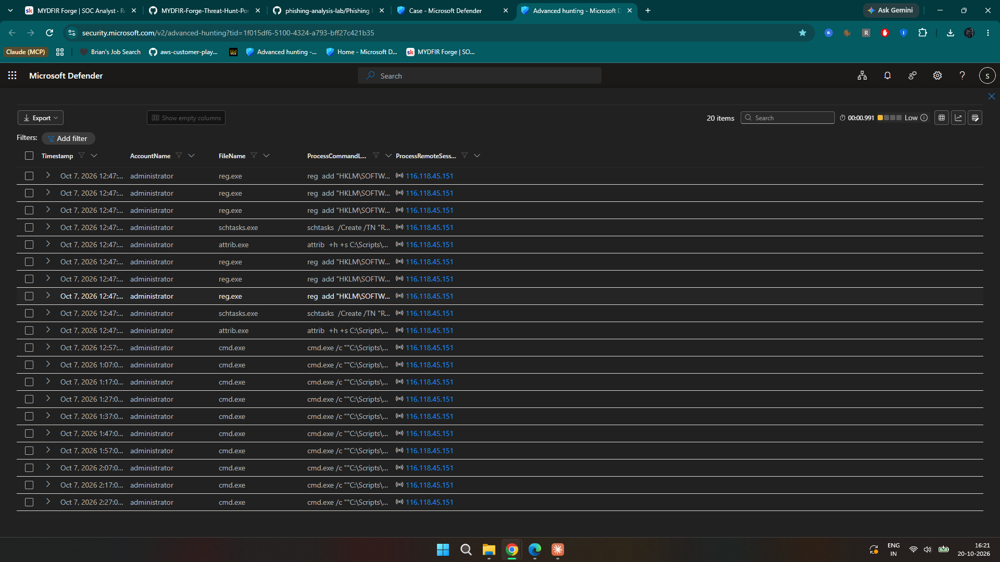
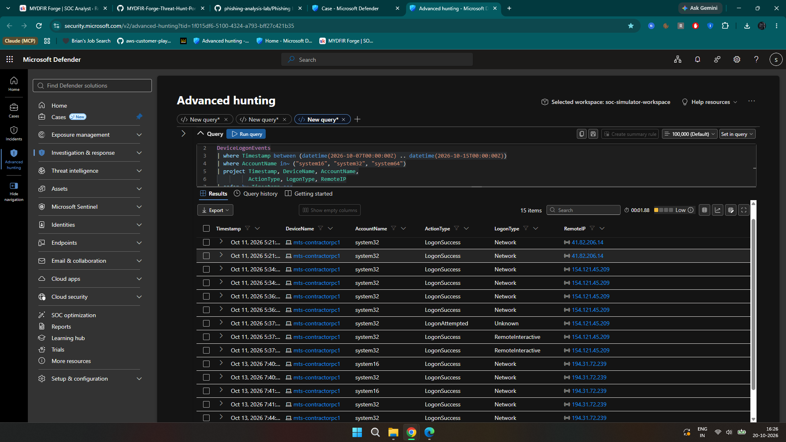
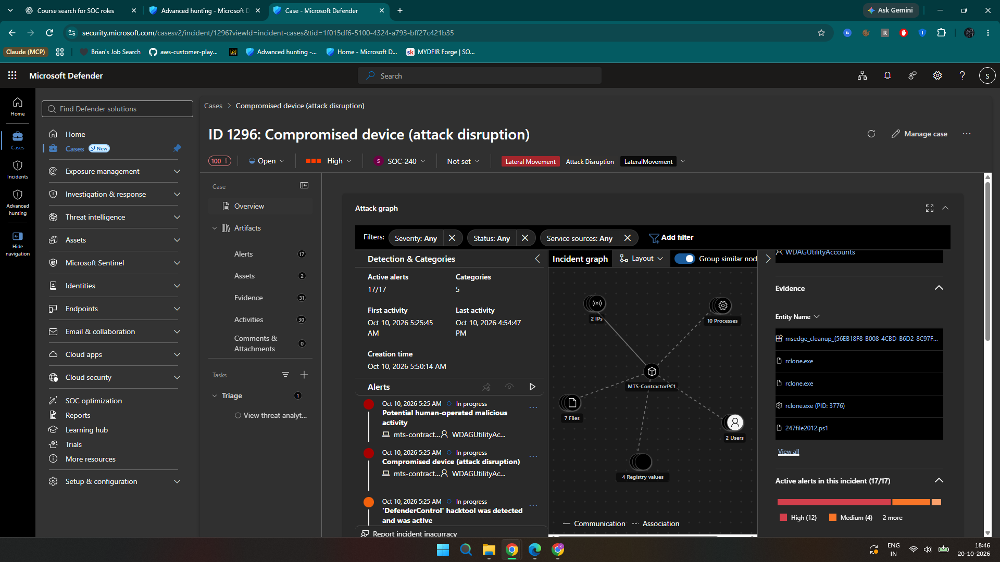
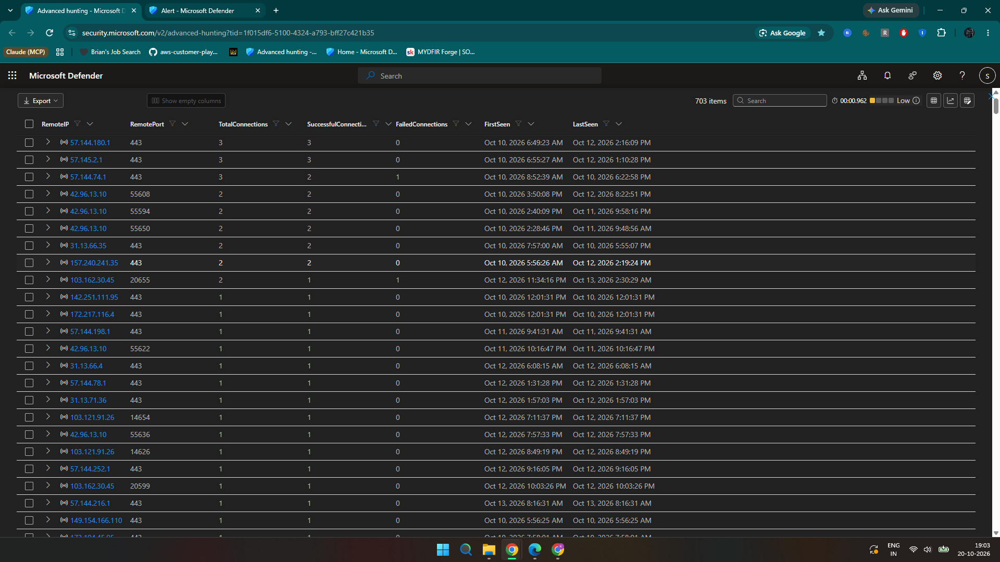

# SOC Investigation Report — RDP Persistence and Endpoint Compromise

**Environment:** MYDFIR Forge SOC lab / Microsoft Defender XDR  
**Cases:** 1290 (Medium, RDP alert) and 1296 / Incident 2565 (High, compromised device)  
**Device:** `mts-contractorpc1`  
**Period:** October 6–15, 2026; times below are CDT (UTC−5)  
**Assessment:** True Positive — malicious persistence and defense evasion. Investigation completed; remediation pending.

## Summary

**The host is compromised.** The logs show three new administrator accounts, hidden account entries, and a scheduled password-reset task. Two of those accounts were used again days later.

A separate high-severity case on the same host involved Defender tampering, `VNLIKE247.exe`, and a Defender alert for suspected data exfiltration. Case 1296 is assessed as **True Positive — Multi-Staged Attack**. Both cases warrant escalation. The business impact is unknown in this lab.

## Timeline

| When (CDT) | What happened | Evidence |
| --- | --- | --- |
| Oct 6, 3:29 PM | `administrator` RDP success from `2.147.252.234` | Starting alert / `DeviceLogonEvents` |
| Oct 6, 3:34 PM | `explorer.exe → cmd.exe → net.exe`, running `net user` | Evidence 1 |
| Oct 7, 12:40 PM | Administrator RDP session; matching Unlock event linked to `116.118.45.151` | Evidence 2 |
| Oct 7, 12:47 PM | `system16`, `system32`, `system64` created and added to Administrators; registry hiding and recurring task configured | Evidence 3, Evidence 4, Evidence 5 |
| Oct 8, 1:00 AM | Another administrator RDP login; source `116.98.254.228` | `DeviceLogonEvents` |
| Oct 10, morning | Defender tampering, `dControl.exe`, and `VNLIKE247.exe` execution | Evidence 8, Evidence 9 |
| Oct 10, 5:56 AM | Defender reported staging/transfer; matching TCP connection to `149.154.166.110:443` | Evidence 11, Evidence 12 |
| Oct 11–13 | Successful logons involving `system32` and `system16` | Evidence 6 |
| Oct 15 | Automated uncontain of `WDAGUtilityAccounts` marked Completed | Evidence 13 |

## How I followed the evidence

I didn't start by searching for the three accounts or `VNLIKE247.exe`. The investigation started with the RDP alert, and each finding led to the next query:

1. **Validate the alert.** I checked `DeviceLogonEvents` for the account, host, login type, source IP and timestamp. Times in this report are CDT; Defender query timestamps are UTC.
2. **Check what the user did after login.** I looked at `DeviceProcessEvents`. My first four-minute window missed `net user`, so I widened the search instead of treating the early Windows processes as the whole session.
3. **Follow the next administrator session.** I reviewed Oct 7 logons. The RDP event had no source IP, so I matched its Logon ID to an `Unlock` event, then used `ProcessRemoteSessionIP` to find the session's process activity.
4. **Test whether the changes persisted.** After finding the local-account, registry and task commands, I searched later authentication across devices for `system16`, `system32` and `system64`. That revealed successful use on Oct 11–13, but no confirmed second internal host.
5. **Check the broader host story.** Looking at other alerts on the same endpoint led me to separate Case 1296. I checked Defender tampering alerts, the `VNLIKE247.exe` process event and its wider network activity. Only after that did I narrow the network query to the IP named in the exfiltration detection.
6. **Check response records.** I reviewed Defender's automated actions to see whether the host had actually been isolated. The isolation actions were skipped.

The narrower queries and screenshots below document findings discovered during these broader checks; they weren't the starting point of the hunt.

## What I found

### RDP activity and persistence

I started with the Oct 6 RDP alert and checked the successful login against `DeviceLogonEvents`. My first process query only covered four minutes. That was too short: when I widened it, I found `net user` account enumeration around 3:34 PM.

The Oct 7 session was more revealing. Its `RemoteInteractive` record had no `RemoteIP`, but an `Unlock` event with the same Logon ID (`72229258`) had `116.118.45.151`. My first attempt to link processes by Logon ID did not return useful results. Pivoting on `ProcessRemoteSessionIP` worked.

From that session, process logs showed commands creating `system16`, `system32`, and `system64`, adding them to the local Administrators group, and hiding them with `Winlogon\SpecialAccounts\UserList` registry entries. A task named `ResetUserPasswords` ran `C:\Scripts\ResetPasswords.cmd` every ten minutes with highest privileges. I found repeated script-related execution after task creation.

I then checked whether those accounts were actually used. `system32` logged on successfully on Oct 11, including a `RemoteInteractive` session; `system16` and `system32` had successful **Network** logons on Oct 13. I checked other devices too, but did not find a second internal host. The Oct 13 entries are Network logons, not RDP. The persistence activity makes the RDP alert a **True Positive** rather than an isolated sign-in anomaly.

*Oct 6: `net user` launched through `cmd.exe` after the RDP login.*

*Oct 7: `RemoteInteractive` and `Unlock` share Logon ID `72229258`; the Unlock event supplies the source IP.*

*Commands involving `system16`, `system32`, `system64`, and Administrators-group changes. Some command lines are truncated.*

*Registry modification, task creation, and later repeated script activity.*

*Two `schtasks.exe` execution records in the administrator's remote session.*

*Successful later sign-ins using the newly created accounts, with logon types shown.*

### Defender tampering and suspicious execution

During host scoping, I found a separate High-severity compromised-device case with 17 alerts. The Oct 10 alert story included `dControl.exe` (DefenderControl), attempts to turn off antivirus, Defender registry/service changes, and PowerShell activity. This is evidence of attempted defense evasion.

`VNLIKE247.exe` executed around 5:52 AM under `wdagutilityaccounts`, launched by `explorer.exe`. Its SHA256 was:

`7392942a2151c61d587d8aa557f30cad09bf2cb528e420f855f2fd84f4fa5072`

*Separate High-severity case on the same endpoint with 17 alerts.*

*DefenderControl and antivirus tampering detections. Attempts are confirmed; successful disablement is not.*

*`VNLIKE247.exe` process event, user context, parent process, and hash.*

### Network activity and suspected transfer

The broad network search for `VNLIKE247.exe` produced **703 IP/port groupings**, not 703 distinct IPs. I then checked the destination from Defender's exfiltration event. `DeviceNetworkEvents` confirmed `VNLIKE247.exe` made a successful TCP connection to `149.154.166.110:443`.

The device timeline reported `SuspiciousProcessDataExfiltration` at 5:56:25 AM, with staging under `C:\Users\WDAGUtilityAccounts\Desktop\vnlike` Evidence 12. IP-registration research associated the destination with Telegram infrastructure. Defender flagged a transfer, but I never found out what was sent, how much, or to whom.

The logs spell this name three ways (`wdagutilityaccounts`, `WDAGUtilityAccounts`, and `WDAGUtilityAccount`), so I kept each as recorded. Staging files under what looks like a normally non-interactive Windows utility account is unusual and worth checking.

I also checked Rclone and WinRAR. The observed Rclone command downloaded an archive **from Google Drive to the device**, not the other way around. Some `vnlike` files appeared before that download. I left the two events separate rather than force a connection.

**Case relationship:** Both cases involve the same host, and `116.98.254.228` appears in the Oct 8 RDP evidence and as an entity in Case 1296. The accounts created on Oct 7 were used again after the Oct 10 detections. That suggests a possible connection, but doesn't prove one operator controlled both cases.

*Broad network summary grouped by destination IP and port.*

*Successful connection by `VNLIKE247.exe` to `149.154.166.110:443`.*

*Defender-reported staging and transfer event, correlated with the network connection.*

## Response status

These were **automated Defender actions**, not changes I made:

| Action | Status |
| --- | --- |
| Contain `WDAGUtilityAccounts` (Oct 10) | Completed |
| Disable `WDAGUtilityAccounts` (Oct 10) | Skipped |
| Isolate `mts-contractorpc1` (twice, Oct 10) | Skipped |
| Uncontain `WDAGUtilityAccounts` (Oct 15) | Completed |

*Automated response outcomes: isolation skipped and uncontain completed.*

### IR handoff

1. **IR / endpoint team:** Verify and, if authorized, isolate the host; check Defender health.
2. **Identity / IR:** Review and disable unauthorized local admin accounts; rotate affected credentials and revoke sessions.
3. **DFIR:** Preserve the binaries, task, script, registry changes, logs, and related network evidence.
4. **IT / IR:** Remove persistence, restore protections, and rebuild if needed; verify recovery.
5. **Threat hunting / system owner:** Check other hosts and establish whether sensitive data was exposed.

## Main indicators

| Indicator | What it was |
| --- | --- |
| `mts-contractorpc1` | Endpoint in both cases |
| `system16`, `system32`, `system64` | New privileged local accounts |
| `ResetUserPasswords`; `C:\Scripts\ResetPasswords.cmd` | Scheduled-task persistence |
| `Winlogon\SpecialAccounts\UserList` | Registry-based account hiding |
| `2.147.252.234`; `116.118.45.151`; `116.98.254.228` | RDP-related source IPs |
| `41.82.206.14`; `154.121.45.209`; `194.31.72.239` | Later authentication source IPs |
| `dControl.exe` | Defender tampering tool detection; no verified hash |
| `VNLIKE247.exe` — SHA256 above | Executed suspicious binary |
| `149.154.166.110:443` | Connection seen at the time of the Defender exfil alert |

**ATT&CK:** T1021.001 (RDP), T1087.001 (account discovery), T1136.001 (local account), T1053.005 (scheduled task), T1564 (hiding), T1562.001 (impair defenses), T1074.001 (staging), T1041 (suspected exfiltration).

## Open questions and handoff status

Outstanding questions: Was the original administrator access authorized? Were both cases operated by the same actor? What data, if any, was transferred? What was the business impact? The incident's containment and recovery have not been verified. Case 1290's Incident ID also needs to be checked in Defender.

**Outcome:** Case 1290 documents malicious account persistence. Case 1296 supports **True Positive / Multi-Staged Attack**. My investigation is ready for handoff; Incident 2565 should stay In Progress until the response team verifies recovery.

[Original screenshot index](EVIDENCE_INDEX.md) · [Hunting queries](queries/investigation.kql) · [Investigation lessons](LEARNING_NOTES.md)
