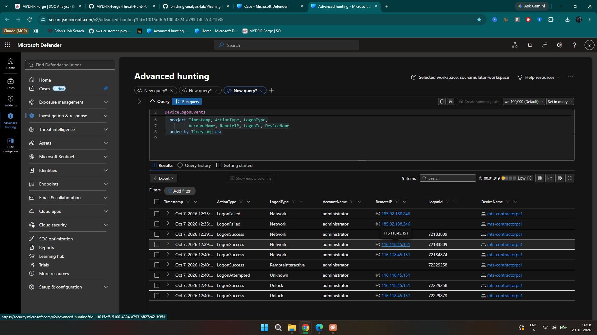
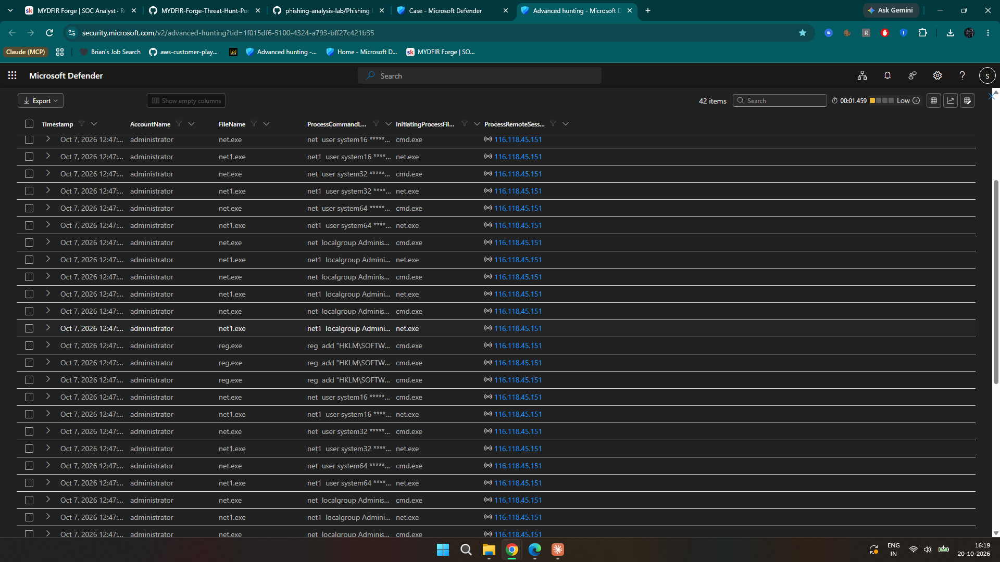
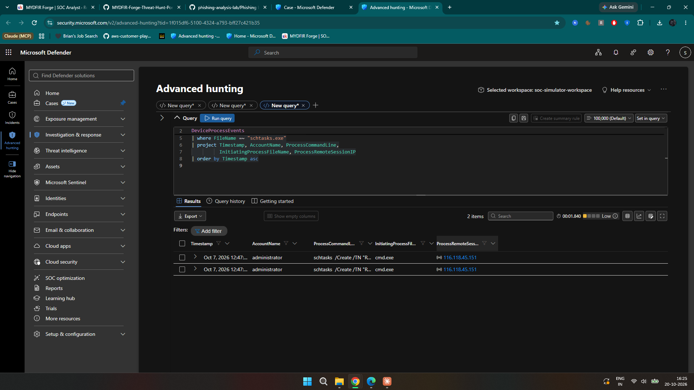
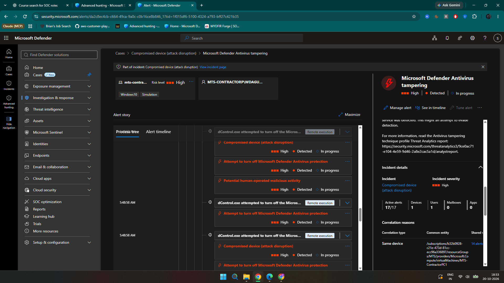
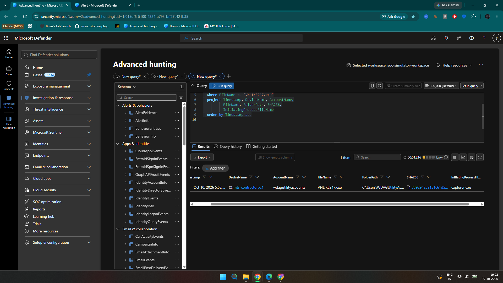
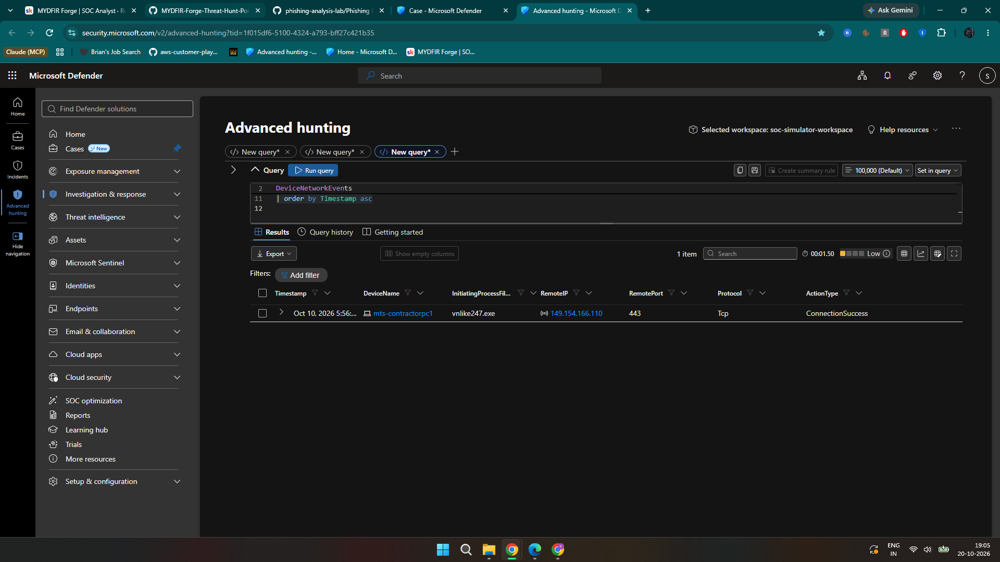
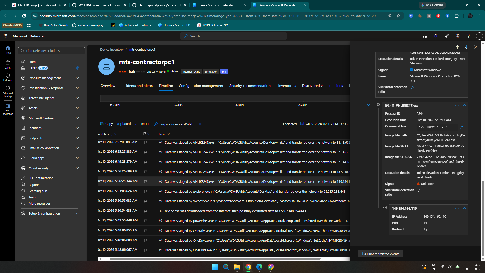
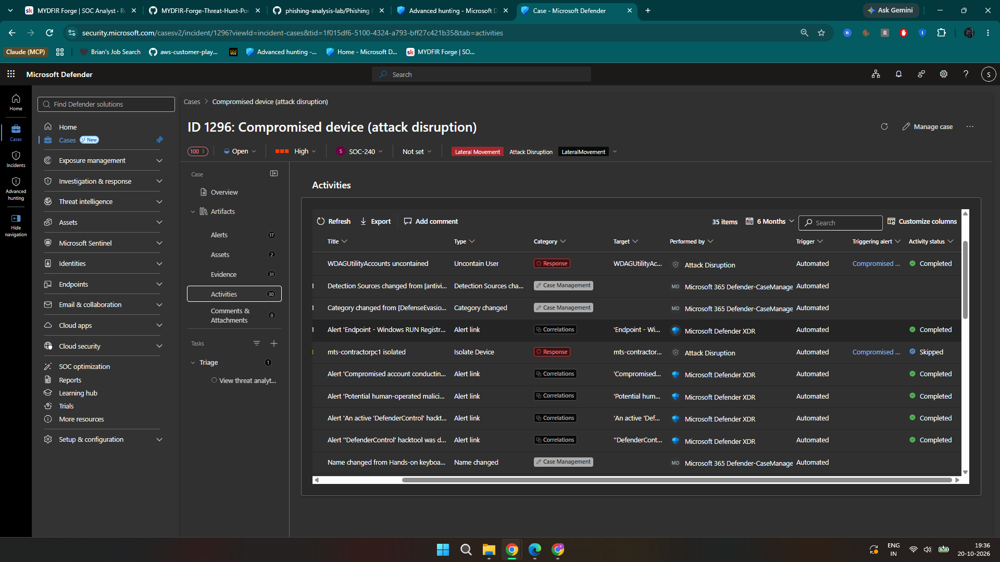

# MYDFIR Forge — Investigation Report

**Cases:** 1290 (RDP alert), 1296 / Incident 2565 (compromised device)  
**Host:** `mts-contractorpc1`  
**Period reviewed:** October 6–15, 2026 (CDT, UTC−5)  
**Assessment:** True Positive — malicious persistence and attempted defense evasion. Suspected data transfer requires further scoping.

## Findings (What did you find)

| Evidence | Result |
| --- | --- |
| RDP source IPs | `2.147.252.234` (Oct 6), `116.118.45.151` (Oct 7), `116.98.254.228` (Oct 8) |
| Local accounts | `system16`, `system32`, `system64` — commands to create and add to Administrators on Oct 7 |
| Persistence | `Winlogon\SpecialAccounts\UserList` registry changes; scheduled task `ResetUserPasswords` running `C:\Scripts\ResetPasswords.cmd` every 10 minutes |
| Account reuse | `system32`: successful Network and RemoteInteractive logons Oct 11; `system16` and `system32`: successful Network logons Oct 13 |
| Defense evasion | `dControl.exe`, DefenderControl detections, attempts to turn off Microsoft Defender Antivirus, and associated registry/service activity on Oct 10 |
| Suspicious executable | `VNLIKE247.exe`; SHA256 `7392942a2151c61d587d8aa557f30cad09bf2cb528e420f855f2fd84f4fa5072` |
| Suspected transfer | Defender flagged data staging in `C:\Users\WDAGUtilityAccounts\Desktop\vnlike` at about 5:56 AM Oct 10; a matching successful TCP connection to `149.154.166.110:443` was found |
| Automated response | Account containment Completed; device isolation Skipped twice; account uncontain Completed on Oct 15 |

## Investigation Summary (What happened)

I started with Case 1290, a successful administrator RDP login on Oct 6. My initial process search covered only four minutes and missed the `net user` commands at 3:34 PM. After expanding the timeframe, I checked the following day's logons.

On Oct 7, the `RemoteInteractive` event had no source IP, but an `Unlock` event with the same Logon ID (`72229258`) showed `116.118.45.151`. Searching processes by Logon ID didn't return useful results; `ProcessRemoteSessionIP` did. The related commands created three local users, added them to Administrators, hid them with registry settings and established a recurring scheduled task. Subsequent logons showed that the accounts were used again on Oct 11–13.

While checking other alerts for the same host, I found separate Case 1296. Its Oct 10 detections showed DefenderControl and attempts to disable antivirus. `VNLIKE247.exe` also executed and made outbound network connections. Defender reported a suspected transfer from the `vnlike` directory, and a network event confirmed a successful connection to the reported destination. WHOIS/RDAP information associated that destination IP with Telegram infrastructure.

I checked later logons across available devices but found no confirmed second internal host. The two cases share a device and some related indicators, but I couldn't prove a single operator controlled both. Defender's automated isolation actions were skipped, so I did not mark the incident remediated.

## Who, What, When, Where, Why, How

**WHO:** The `MTS-CONTRACTORP\administrator` account was used for the RDP sessions. The subsequently created `system16` and `system32` accounts were used for later logons. `wdagutilityaccounts` appeared as the process account for `VNLIKE247.exe`. The person or persons controlling these accounts are unknown.

**WHAT:** Suspicious RDP access followed by local-account creation, privilege assignment, hidden-account and scheduled-task persistence. A separate high-severity case identified attempted Defender tampering and suspected data transfer.

**WHEN:** Oct 6, 3:29 PM CDT: administrator RDP login; about 3:34 PM: account discovery. Oct 7, about 12:40–12:47 PM: RDP session and persistence commands. Oct 10, about 5:48–5:56 AM: Defender tampering, `VNLIKE247.exe` execution and suspected transfer. Oct 11–13: later account logons. Oct 15: automated account uncontain. Continued malicious activity after these observations was not established.

**WHERE:** `mts-contractorpc1` in the MYDFIR Forge simulation. The suspicious binary ran from a `WDAGUtilityAccounts` Desktop folder in the telemetry. These logs use `wdagutilityaccounts`, `WDAGUtilityAccounts`, and `WDAGUtilityAccount` in different contexts; spellings are preserved. The folder location is unusual for a normally non-interactive utility account.

**WHY:** The hidden admin accounts, password-reset task and Defender tampering point to maintaining privileged access and making detection harder. The attacker's initial entry method, identity and full intent remain unknown.

**HOW:** A remote administrator session was followed by `cmd.exe`/`net.exe` user-management commands, `reg.exe` changes and `schtasks.exe` persistence. On Oct 10, `dControl.exe` and related alerts showed attempts to impair Defender. `VNLIKE247.exe` later connected to external IPs, including `149.154.166.110:443`, at the time Defender recorded suspected staging and transfer. The exact files, amount of data and recipient weren't recovered.

## Recommendations

1. **Contain access:** Verify the host's isolation status and isolate if authorized; disable the three suspicious local accounts, review administrator access, and rotate compromised credentials.
2. **Preserve evidence:** Collect the process, logon and network logs; suspicious binary, scheduled task, script and registry entries before cleanup.
3. **Investigate scope:** Hunt other endpoints for the account names, task, file hash, related RDP sources and Defender-tampering activity. Validate whether the two cases represent the same intrusion.
4. **Check data exposure:** Review file contents, relevant network or proxy telemetry, and the suspected transfer destination to determine what was sent.
5. **Recover and verify:** Remove persistence, restore Defender protections, rebuild the endpoint if necessary, and confirm remediation before resolving the high-severity incident.

**Lab outcome:** Investigation documented and classified as True Positive. Automated isolation was skipped, and no manual remediation was performed or verified. Incident 2565 should remain In Progress pending response validation.

## Selected evidence

**RDP correlation and persistence**

**Defender tampering and suspicious executable**

**Suspected transfer and response status**

[Full investigation and additional screenshots](INVESTIGATION_REPORT.md) · [KQL queries](queries/investigation.kql)
